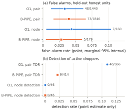

# Results and interpretation

All values below are copied from the authoritative outputs of the single confirmatory run. They are hash-verified and were not recomputed.

**Only the primary comparison is confirmatory; every secondary result is descriptive.**

## Precheck

| Item | Value |
|---|---|
| Common judged set | 1,806 pairs (1,440 honest, 366 active-dropper) |
| P(undefined) | ≈ 1.685 × 10⁻¹² |
| ε | 0.005 |
| Decision | **ESTIMABLE** |

**Replay check:** the integrated run's recomputed precheck matched the recorded reference exactly before any calibration was loaded.

## Primary result (confirmatory)

| Quantity | Exact | Decimal |
|---|---|---|
| ΔAUC (O1 − B-PIPE) | 409/210816 | +0.00194 |
| Lower bound L (2.5 %) | −9753995305/417299039168 | −0.02337 |
| Upper bound U (97.5 %) | 79237754887/2469645220400 | +0.03208 |
| δ − U | 44244506133/2469645220400 | +0.017915 |
| Verdict | **V5** | L ≤ 0 and 0 < U < δ = 0.05 |

**Bootstrap:** 10,000 valid replicates, 0 discarded. The floating-point cross-check differed by at most 2.1 × 10⁻¹⁷.

**Frozen statement:** "Meaningful improvement ruled out: an improvement of at least δ = 0.05 of O1 over B-PIPE in conditional discrimination on the pairs both methods judge is ruled out (95 % interval [−0.023, 0.032]). A smaller positive effect is neither shown nor excluded."

## Secondary results (descriptive; they do not alter the primary verdict)

| Measure | O1 | B-PIPE |
|---|---|---|
| Pair false alarms | 48/1,440 = 0.033 [0.013, 0.061] | 73/1,846 = 0.040 [0.017, 0.065] |
| Node false alarms | 7/160 = 0.044 [0.006, 0.103] | 5/179 = 0.028 [0.005, 0.059] |
| Node detection (all 46 active droppers) | 0/46 | 0/46 |
| Pair TDR (judged active-dropper pairs) | 40/366 = 0.109 | 9/414 = 0.022 |
| Pair threshold | 0.51199 | 0.50383 |
| Node threshold | 0.69449 | 0.55106 |

**Reading the secondary results:**
- **False alarms:** each interval is a separate marginal interval; they are not joint.
- **Thresholds:** the pair and node thresholds differ, and each is specific to its method.
- **Detection and TDR:** these have **no confidence intervals** under the frozen protocol, and were not tested.
- **Zero detection:** the 0/46 node-level count describes these thresholds and this population. It is **not** proof that detection is impossible.

## How to interpret V5

| Supported | Not supported |
|---|---|
| By the predeclared interval rule, an improvement of ≥ 0.05 in conditional AUC from HH-VBF eligibility conditioning is ruled out | "The methods are equivalent" |
| A smaller positive effect is neither shown nor excluded | "O1 has no benefit" or "O1 is worse" |
| The conclusion concerns the pairs both methods judge | Any statement about pairs only one method judges |
| — | That the 95 % interval has nominal coverage (not established with ten seed clusters) |
