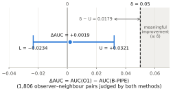
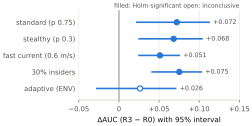
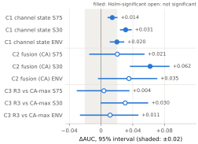

# Results and interpretation

Every number on this page is taken from the frozen, hash-verified outputs of the three studies; none was typed by hand.

## Study A: do HH-VBF eligibility rules help a single observer?

| Quantity | Exact | Decimal |
|---|---|---|
| ΔAUC (O1 − B-PIPE), on the 1,806 pairs both judge | 409/210816 | +0.0019 |
| Lower bound L (2.5 %) | -9753995305/417299039168 | -0.0234 |
| Upper bound U (97.5 %) | 79237754887/2469645220400 | +0.0321 |
| δ − U | 44244506133/2469645220400 | 0.0179 |
| **Verdict** | **V5** | an improvement of at least 0.05 is ruled out; a smaller positive effect is neither shown nor excluded |

With the max-pair node rule, neither method detected any of the 46 active droppers (0/46 and 0/46). Pair-level detection was 40/366 for O1 and 9/414 for B-PIPE (descriptive).

## Study B: does combining observers help?

| Condition | AUC R0 | AUC R3 | Change [95 % interval] | p (one-sided) | Decision |
|---|---|---|---|---|---|
| S75 (standard) | 0.654 | 0.727 | +0.072 [+0.021, +0.113] | 0.0059 | replicated |
| S30 (stealthy) | 0.612 | 0.680 | +0.068 [+0.024, +0.104] | 0.0020 | replicated |
| ENV (adaptive) | 0.649 | 0.675 | +0.026 [-0.029, +0.072] | 0.153 | inconclusive |
| V06 (fast current) | 0.631 | 0.682 | +0.051 [+0.024, +0.076] | 0.0002 | replicated |
| AF30 (30 % insiders) | 0.673 | 0.748 | +0.075 [+0.040, +0.104] | 0.0002 | replicated |

**Detection at the frozen thresholds** (detected / eligible active droppers, then honest false-alarm rate; descriptive):

| Condition | R0 | R3 | BETA | full7 |
|---|---|---|---|---|
| S75 | 6/99 · 4.6% | 65/93 · 5.6% | 32/93 · 4.2% | 54/93 · 4.2% |
| S30 | 9/108 · 4.2% | 14/106 · 6.1% | 4/106 · 4.0% | 6/106 · 4.9% |
| ENV | 6/95 · 3.9% | 11/92 · 5.6% | 7/92 · 3.6% | 4/92 · 4.2% |
| V06 | 4/125 · 2.0% | 79/116 · 3.6% | 45/116 · 3.1% | 65/116 · 3.3% |
| AF30 | 10/167 · 4.2% | 98/159 · 4.2% | 50/159 · 3.2% | 98/159 · 3.9% |

R0 needs one judging observer and the others need three, so eligibility differs between columns. In the standard condition, R3 detected 52.0% of all active droppers against 4.8% for R0.

**Lying observers (secondary).** With worst-case liars, the max rule collapsed (AUC 0.218–0.277), and R3's advantage was +0.317 to +0.427; honest false alarms of R3 rose to 7.9%–16.6%.

**Coverage and collisions.** On clean networks, honest R3 scores rose with the number of judging observers in 28/30 networks (mean Spearman +0.416, 95 % interval [+0.320, +0.502]). Counting genuine forwards the observer never heard as heard reduced this by +0.274 [+0.198, +0.352]. Between 17.2% and 21.7% of genuine forwards were lost to collisions at the observer.

## Study C: comparison with an adapted channel-aware trust model

| Contrast | Condition | Change | 95 % interval | p | Verdict |
|---|---|---|---|---|---|
| C1 channel state | S75 | +0.0141 | [+0.0082, +0.0208] | 0.0002 | difference |
| | S30 | +0.0310 | [+0.0238, +0.0386] | 0.0002 | difference |
| | ENV | +0.0200 | [+0.0109, +0.0293] | 0.0004 | difference |
| C2 fusion (CA) | S75 | +0.0206 | [-0.0148, +0.0549] | 0.255 | inconclusive |
| | S30 | +0.0618 | [+0.0364, +0.0863] | 0.0002 | difference |
| | ENV | +0.0352 | [-0.0038, +0.0709] | 0.072 | inconclusive |
| C3 R3 vs CA-max | S75 | +0.0036 | [-0.0306, +0.0358] | 0.845 | inconclusive |
| | S30 | +0.0305 | [-0.0006, +0.0594] | 0.055 | inconclusive |
| | ENV | +0.0114 | [-0.0266, +0.0471] | 0.533 | inconclusive |

- The comparator's channel state comes from the simulator's own collision log, so its benefit here is likely an upper bound; the simulator has no environmental noise.
- The comparator's maximum rules cannot flag any node at their frozen threshold, so their detection figures are not meaningful (their AUC results are).
- Study C was completed under a documented recovery amendment after an accidental interruption: the 20 missing runs were re-executed with their original commands and checked before the single evaluation.

## Results that did not hold up

- **full7**, a coverage-based adjustment, helped in development but failed its generalisation test in all three shifted conditions and did not replicate in Study B.
- **Observer-side corrections** (detecting duplicate copies, predicting collisions from timing) were rejected: the observer does not see enough to recover what ground truth shows.

## How to read these results

| Supported in this scenario | Not supported |
|---|---|
| HH-VBF eligibility rules do not give a single observer a gain of 0.05 AUC or more | that the eligibility rules are useless or harmful |
| Median fusion beats the max-pair rule in four of five conditions | that it beats the max rule against the adaptive attacker |
| Honest scores rise with coverage; collisions explain part of it | that the effect holds in noisy real channels |
| Channel-state evidence adds a small gain on top of median fusion | that our fusion rule outperforms the channel-aware comparator |
