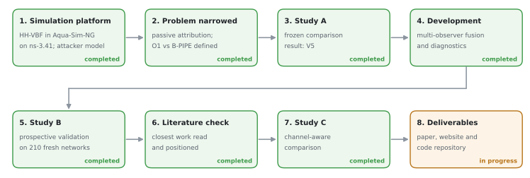

# Team and progress

## Team

| Item | Value |
|---|---|
| Project | Final-year project 23CSE498 |
| Group | GROUP-103 |
| Department | Computer Science and Engineering, Amrita Vishwa Vidyapeetham, Coimbatore |

### Team members

1. Aswin L
2. Chethana S Nair
3. Devika Janardanan
4. Liya Susan Reji

## How the work progressed

| Stage | Outcome |
|---|---|
| 1. Simulation platform | HH-VBF in Aqua-Sim-NG on ns-3.41, with a selective-forwarding attacker model |
| 2. Problem narrowed | passive attribution; the O1 observer and the B-PIPE baseline defined |
| 3. Study A | frozen comparison of O1 and B-PIPE: verdict V5 |
| 4. Development | multi-observer fusion and diagnostics of honest silence |
| 5. Study B | prospective validation on 210 fresh networks |
| 6. Literature check | closest published work read and positioned |
| 7. Study C | comparison with an adapted channel-aware trust model |
| 8. Deliverables | research paper, this website and the code repository |

## Links

- **Code repository:** [github.com/chethana100/uwsn](https://github.com/chethana100/uwsn)
- **This website:** built with MkDocs and hosted with GitHub Pages.
